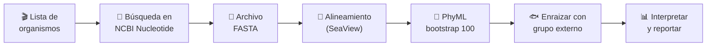

# 🧬 Filogenia de la Hemoglobina α1

### Práctica de Bioinformática · Biología Celular

🌐 **Versión web:** <https://rgescobedo.github.io/filogenia-hemoglobina/>

**Reconstrucción filogenética a partir del gen de la hemoglobina subunidad alfa 1 (*HBA1*) con NCBI GenBank y SeaView**

Universidad Autónoma de Chihuahua · Facultad de Zootecnia y Ecología
Elaboró: **Dr. Román González Escobedo**

---

## 📖 Descripción

La hemoglobina es la proteína que transporta oxígeno en la sangre de los vertebrados. Su subunidad alfa está codificada por el gen *HBA1*, que se conserva en todos los vertebrados pero acumula pequeñas diferencias a lo largo de la evolución. Esas diferencias son las que nos permiten **reconstruir el parentesco entre especies**.

En esta práctica cada estudiante construirá su propia base de datos de secuencias de *HBA1*, las alineará y obtendrá un árbol filogenético por máxima verosimilitud con soporte *bootstrap*.

> *"Sin el marco de referencia de la filogenia, la biología se vuelve una larguísima colección de anécdotas más o menos inconexas."* — Eguiarte et al. (1997)

## 🎯 Objetivo

Conocer los fundamentos del análisis filogenético y realizar la reconstrucción filogenética a partir de secuencias del gen de la **hemoglobina subunidad alfa 1** de diferentes organismos.

### Al terminar, el estudiante podrá:

- [x] Buscar y descargar secuencias nucleotídicas en **NCBI GenBank**
- [x] Distinguir el gen correcto (*HBA1*) de genes parecidos (*HBB*, *HBA2*, *AHSP*)
- [x] Construir un archivo **FASTA** con varias secuencias
- [x] Realizar un **alineamiento múltiple** de secuencias
- [x] Reconstruir un árbol con **PhyML** y evaluar su confiabilidad con **bootstrap**
- [x] **Enraizar** el árbol con un grupo externo e interpretar su topología

## 🔄 Flujo de trabajo

## 🗂️ Contenido del repositorio

| Sección | Archivo | Para qué sirve |
| --- | --- | --- |
| 🛠️ **Parte 1** | [Instalación de SeaView](docs/01_instalacion_seaview.md) | Descargar y abrir el programa |
| 🗃️ **Parte 2** | [Base de datos en NCBI](docs/02_base_de_datos_ncbi.md) | Elegir organismos y descargar las secuencias de *HBA1* |
| 🧩 **Parte 3** | [Alineamiento múltiple](docs/03_alineamiento.md) | Alinear las secuencias |
| 🌳 **Parte 4** | [Árbol filogenético](docs/04_arbol_filogenetico.md) | PhyML, bootstrap, enraizado y exportación |
| 📝 **Entregable** | [Plantilla de reporte](plantillas/reporte_practica.md) | Formato que entrega cada estudiante |
| 📋 **Entregable** | [Tabla de organismos (.csv)](plantillas/tabla_organismos.csv) | Tabla 1 para llenar |
| 🧪 **Datos** | [Formato FASTA](datos/README.md) | Cómo debe verse el archivo de secuencias |

## ⚡ Inicio rápido

1. Instala **[SeaView](http://doua.prabi.fr/software/seaview)** para tu sistema operativo.
2. Haz la lista de los animales de la película en la [tabla de organismos](plantillas/tabla_organismos.csv) e **incluye un pez** como grupo externo (sugerencia: el pez payaso de *Buscando a Nemo*).
3. Descarga una secuencia de *HBA1* por organismo desde **[NCBI Nucleotide](https://www.ncbi.nlm.nih.gov/nuccore/)**, en formato FASTA.
4. Alinea las secuencias en SeaView (**Align → Align all**).
5. Corre **PhyML** con **100 réplicas de bootstrap**.
6. Enraiza con el pez, activa *Br support* y guarda el árbol en PDF.
7. Completa la [plantilla de reporte](plantillas/reporte_practica.md).

## 💻 Requisitos

| Recurso | Detalle |
| --- | --- |
| Equipo | Windows, macOS o Linux; 4 GB de RAM o más recomendado |
| Software | [SeaView](http://doua.prabi.fr/software/seaview) (incluye MUSCLE/Clustal y PhyML) |
| Internet | Para consultar [NCBI](https://www.ncbi.nlm.nih.gov/) |
| Opcional | [Inkscape](https://inkscape.org/es/) para convertir el árbol de SVG a PNG/JPG |

## 📚 Referencias

- Eguiarte L.E., Souza V., Núñez-Farfán J., Hernández-Baños B. (1997). El análisis filogenético: métodos, problemas y perspectivas. *Boletín de la Sociedad Botánica de México* 60: 169-181.
- Gouy M., Guindon S., Gascuel O. (2010). SeaView version 4: a multiplatform graphical user interface for sequence alignment and phylogenetic tree building. *Molecular Biology and Evolution* 27(2): 221-224.
- National Center for Biotechnology Information (NCBI) [Internet]. Bethesda (MD): National Library of Medicine (US). Disponible en: <https://www.ncbi.nlm.nih.gov/>

## 📄 Licencia

Material didáctico bajo licencia [Creative Commons BY-NC-SA 4.0](https://creativecommons.org/licenses/by-nc-sa/4.0/deed.es): puedes usarlo y adaptarlo con fines no comerciales, citando al autor y compartiendo bajo la misma licencia.

---

Universidad Autónoma de Chihuahua · Facultad de Zootecnia y Ecología

