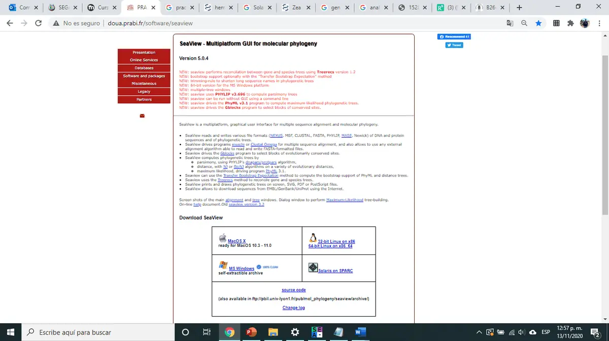
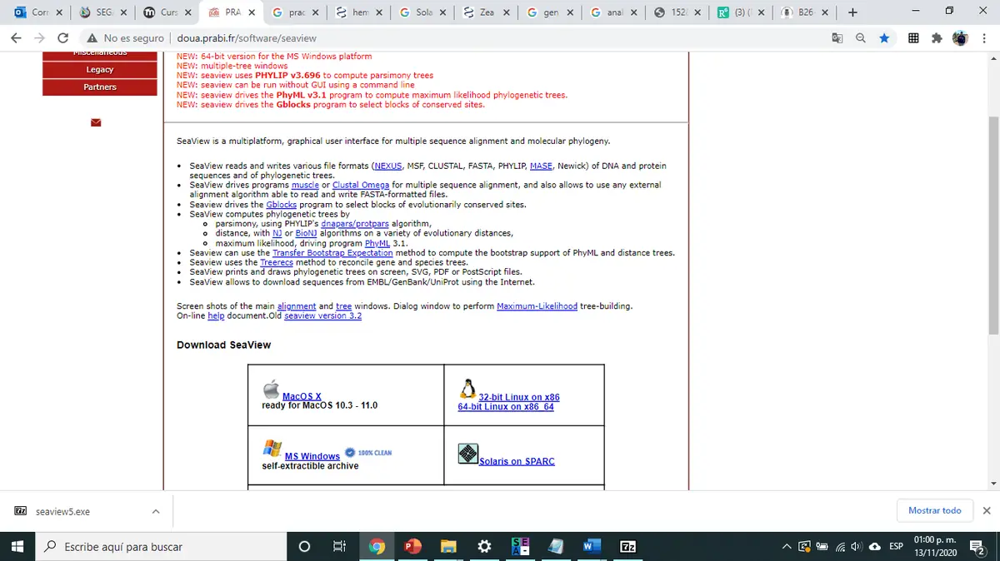
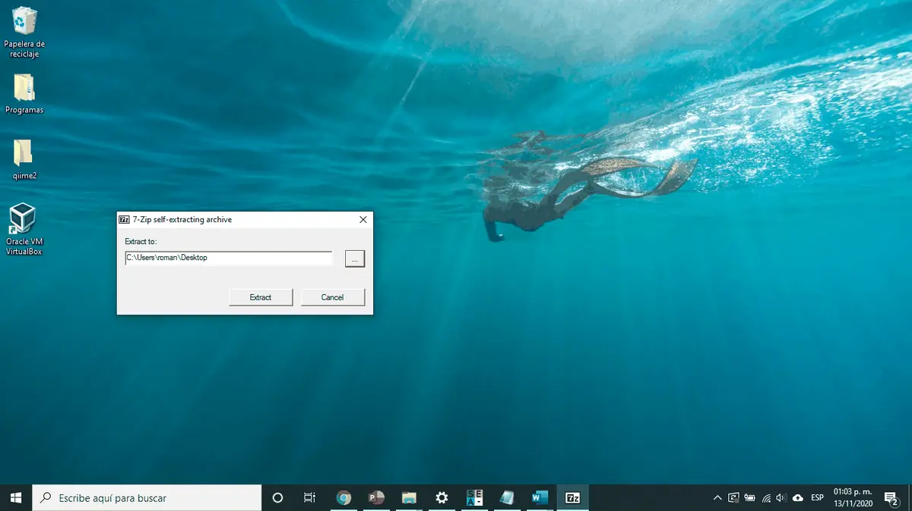
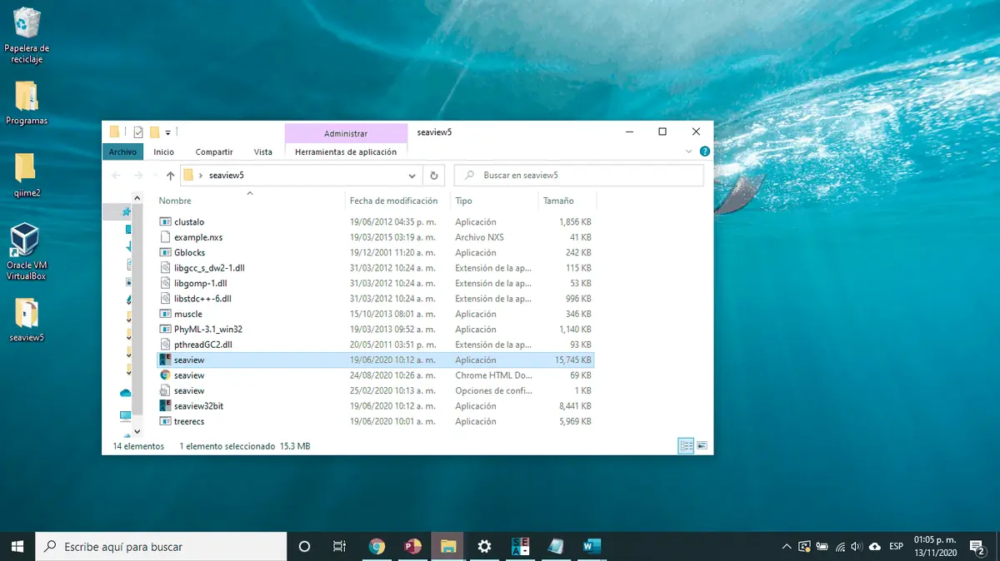
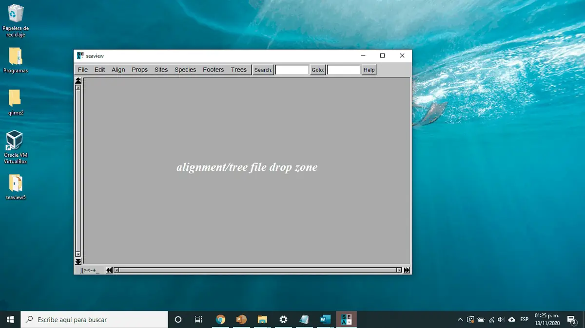

[🏠 Inicio](../README.md) · **Parte 1** · [Parte 2 →](02_base_de_datos_ncbi.md)

# 🛠️ Parte 1 · Instalación de SeaView

**SeaView** es un programa gratuito con interfaz gráfica para alinear secuencias y construir árboles filogenéticos (Gouy et al., 2010). Incluye los alineadores MUSCLE y Clustal Omega y el programa de máxima verosimilitud PhyML, así que no necesitas instalar nada más.

---

### Paso 1 · Descarga el programa

Entra a la página oficial de SeaView y descarga la versión que corresponde al sistema operativo de tu equipo (Windows, macOS o Linux).

🔗 <http://doua.prabi.fr/software/seaview>

### Paso 2 · Ejecuta el archivo descargado

Ejecútalo y guárdalo en la ubicación que prefieras. Te pedirá descomprimir el archivo y crear una carpeta.

### Paso 3 · Abre SeaView

Se creará una carpeta; ábrela y da doble clic en el programa **SeaView**.

### Paso 4 · Verifica que funciona

Si se abre una ventana como la siguiente, el programa está listo. Por ahora puedes cerrarlo.

> [!TIP]
> En macOS, si aparece el aviso de "desarrollador no identificado", haz clic derecho sobre SeaView → **Abrir**.

---

[🏠 Inicio](../README.md) · **Parte 1** · [Parte 2: Base de datos en NCBI →](02_base_de_datos_ncbi.md)
