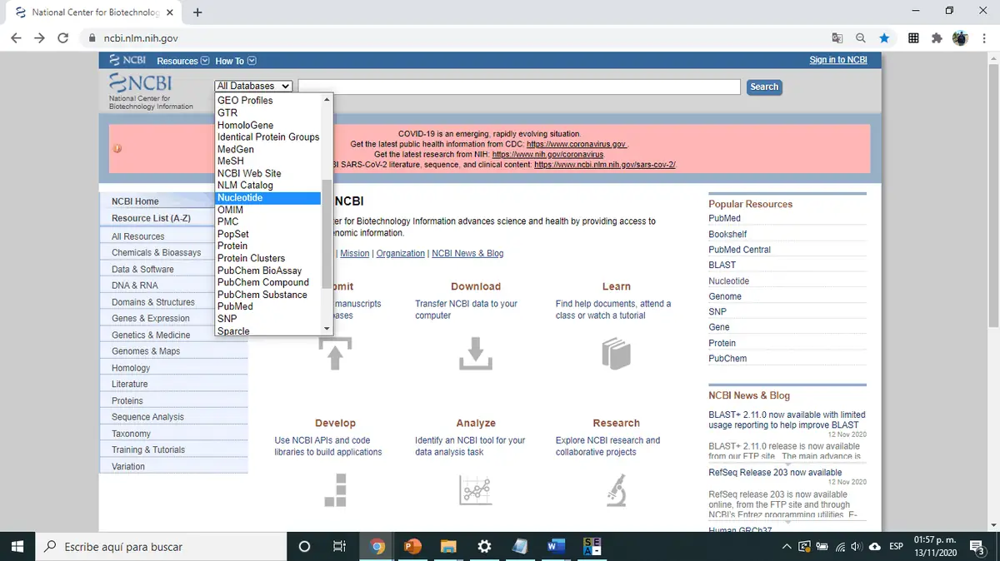
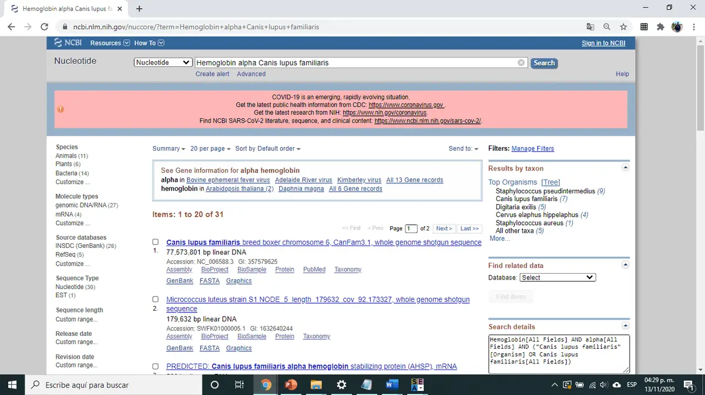
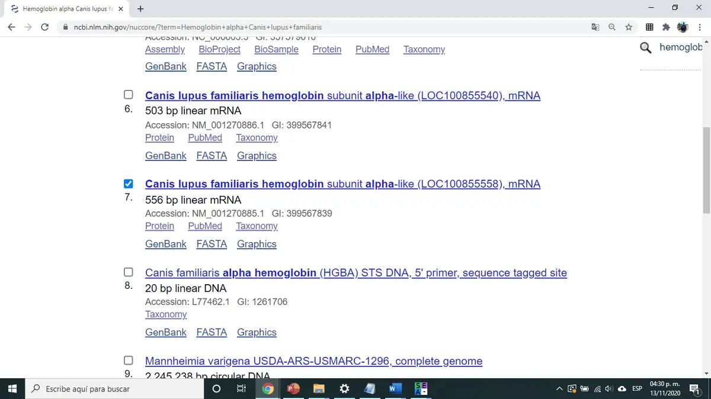
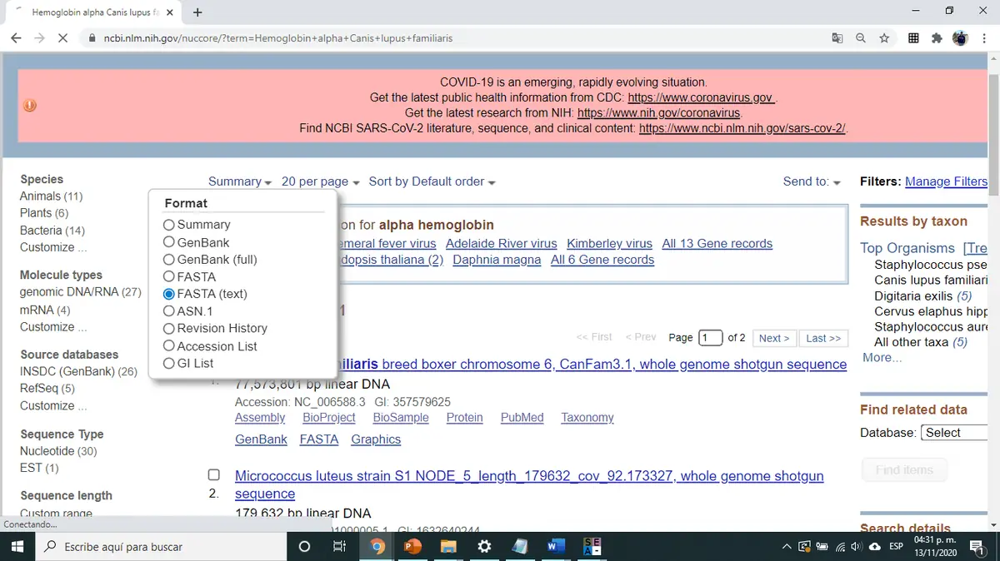
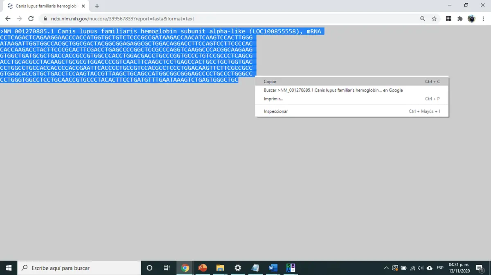
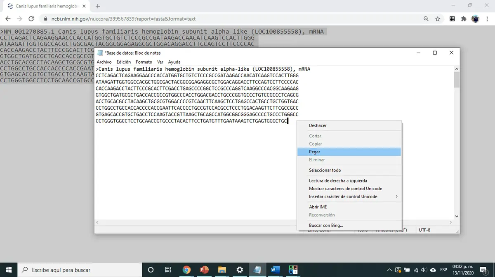
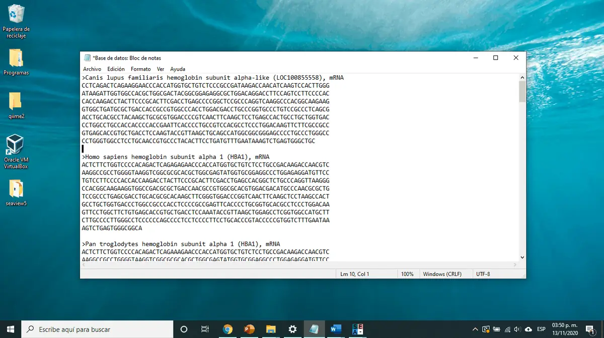

[🏠 Inicio](../README.md) · [← Parte 1](01_instalacion_seaview.md) · **Parte 2** · [Parte 3 →](03_alineamiento.md)

# 🗃️ Parte 2 · Construcción de la base de datos en NCBI

En esta parte crearás un archivo **FASTA** con una secuencia del gen de la **hemoglobina subunidad alfa 1 (*HBA1*)** por cada organismo de tu lista.

---

### Paso 5 · Elige tus organismos

Revisa la película **"Sing ¡Ven y canta!"** y elabora una lista de los **animales** que aparecen. Para cada uno, investiga su **nombre científico**: lo usarás para buscar en GenBank.

Registra la información en la [tabla de organismos](../plantillas/tabla_organismos.csv):

| Número | Personaje / nombre común | Nombre científico | Imagen |
| :---: | --- | --- | :---: |
| 1 | | | |
| 2 | | | |
| … | | | |

> [!NOTE]
> Usa solo **vertebrados** (mamíferos, aves, reptiles, anfibios y peces). Los invertebrados que aparecen en la película, como calamares, caracoles o arañas, **no tienen el gen *HBA1***. Si un animal aparece varias veces (por ejemplo, perros de distintas razas), cuenta como **una sola especie**.

#### 🐠 El grupo externo: un pez

Agrega a tu lista **un pez**, aunque no aparezca en la película. Lo usarás como **grupo externo** para enraizar el árbol en la [Parte 4](04_arbol_filogenetico.md#paso-20--enraiza-el-árbol-con-el-grupo-externo).

Te sugerimos al **pez payaso** (*Amphiprion ocellaris*), la especie de **Nemo** en *Buscando a Nemo*. Puedes usar directamente esta secuencia:

| Pez | Nombre científico | Secuencia en NCBI | Nombre en tu FASTA |
| --- | --- | --- | --- |
| 🐠 Pez payaso (Nemo) | *Amphiprion ocellaris* | [XM_023279594.3](https://www.ncbi.nlm.nih.gov/nuccore/XM_023279594.3) (576 pb) | `>Amphiprion_ocellaris` |
| 🐟 Pez cebra (alternativa) | *Danio rerio* | [NM_131257.3](https://www.ncbi.nlm.nih.gov/nuccore/NM_131257.3) (584 pb) | `>Danio_rerio` |

> [!TIP]
> En NCBI, la secuencia del pez payaso aparece como *"hemoglobin embryonic subunit alpha"*. Es correcta para esta práctica: en los peces las globinas alfa se nombran distinto y, como solo la usamos como grupo externo, funciona perfectamente.

### Paso 6 · Entra a NCBI Nucleotide

Ve a <https://www.ncbi.nlm.nih.gov/> y selecciona la base de datos **Nucleotide**.



### Paso 7 · Busca el gen de la hemoglobina alfa

Escribe el nombre del gen seguido del nombre científico del organismo. Por ejemplo:

```text
Hemoglobin alpha Canis lupus familiaris
```



> [!CAUTION]
> **¡Cada gen es único, ten cuidado!** Entre los resultados aparecerán genes parecidos que **NO** debes usar:
>
> | ❌ No usar | Por qué |
> | --- | --- |
> | Hemoglobina subunidad **beta** (*HBB*) | Es otro gen |
> | Hemoglobina subunidad **alfa 2** (*HBA2*) | Es un gen distinto (parálogo) |
> | **AHSP** (*alpha hemoglobin stabilizing protein*) | Es una proteína diferente, aunque su nombre contenga "alpha hemoglobin" |
>
> Si mezclas estos genes, algún organismo aparecerá agrupado donde no le corresponde.

> [!TIP]
> **¿No encuentras el gen?**
> 1. Busca solo con el **género** en lugar de género + especie.
> 2. Si aun así no aparece, sustitúyelo por un **organismo emparentado** (mismo género o familia) y corrige la tabla.

### Paso 8 · Selecciona la secuencia correcta

Con **una secuencia por organismo** es suficiente. Notarás que las secuencias correctas tienen una **longitud parecida**; en el ejemplo, la secuencia tiene **556 pb**, que corresponde a la longitud aproximada del ARNm de *HBA1*.



> [!NOTE]
> Si una secuencia mide mucho más (varios miles de pb), probablemente es un fragmento genómico o un cromosoma completo. Busca otra.

### Paso 9 · Cambia a formato FASTA

Da clic en **Summary** y selecciona **FASTA (text)**.



### Paso 10 · Copia la secuencia a un archivo de texto

Selecciona toda la secuencia, cópiala y pégala en un bloc de notas. Guarda el archivo en una carpeta de tu elección (por ejemplo `HBA1_base_de_datos.fasta`).



### Paso 11 · Edita el encabezado

**Siempre conserva el símbolo `>`**: es lo que le indica a SeaView dónde empieza cada secuencia. Solo reemplaza el texto que sigue por el nombre del organismo, uniendo género y especie con guion bajo:

```diff
- >XM_000000000.1 PREDICTED: Canis lupus familiaris hemoglobin subunit alpha (HBA1), mRNA
+ >Canis_lupus_familiaris
```



> [!WARNING]
> Evita espacios, acentos, paréntesis y signos en los nombres. Usa solo letras, números y `_`.

### Paso 12 · Completa tu base de datos

Repite los pasos 7–11 con cada organismo de la tabla. Deja una línea en blanco entre secuencias y **guarda el archivo** al terminar.



Consulta un ejemplo del formato esperado en [`datos/README.md`](../datos/README.md).

> [!TIP]
> Puedes agregar más secuencias si lo deseas: más de una secuencia de *HBA1* por organismo, u organismos extra que te interesen.

---

[🏠 Inicio](../README.md) · [← Parte 1](01_instalacion_seaview.md) · **Parte 2** · [Parte 3: Alineamiento →](03_alineamiento.md)
