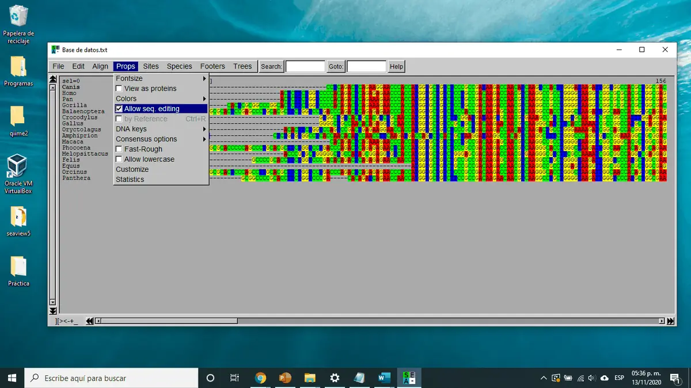
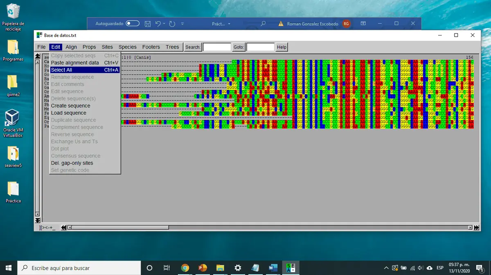
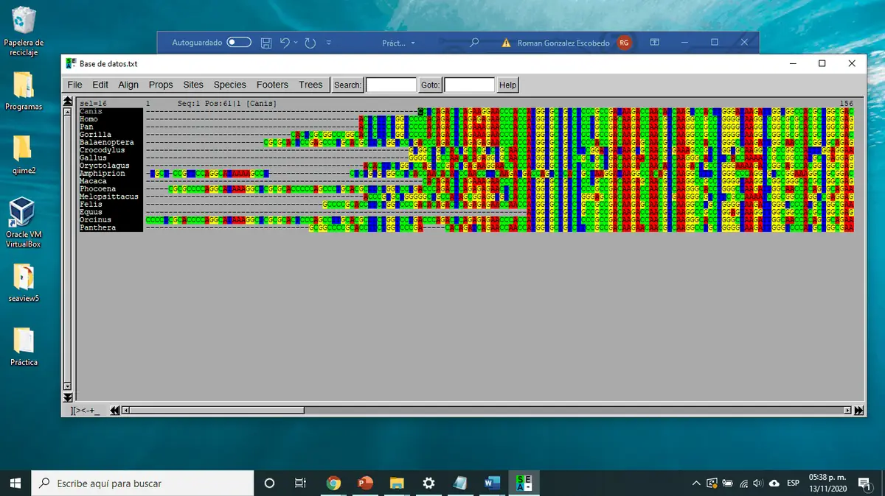
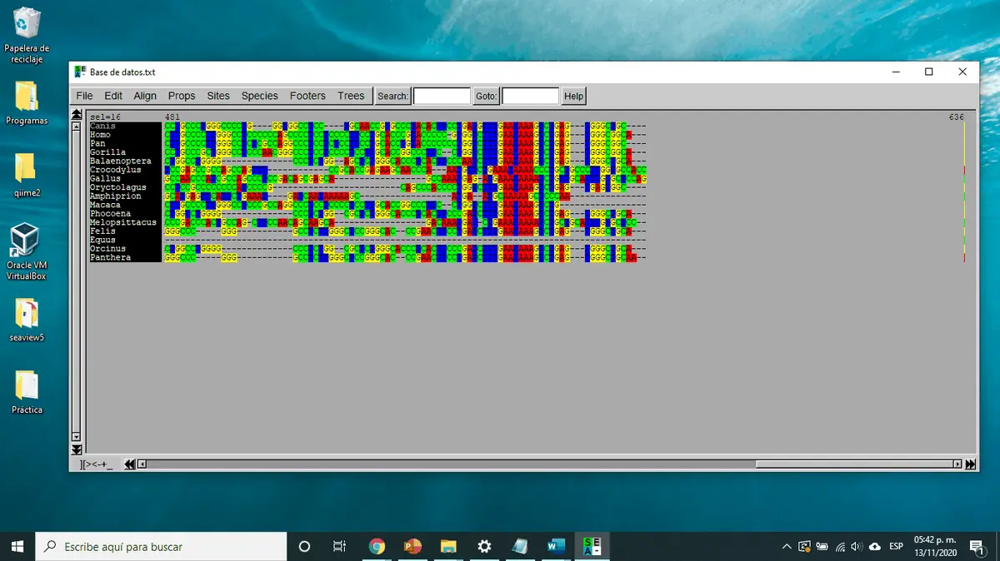
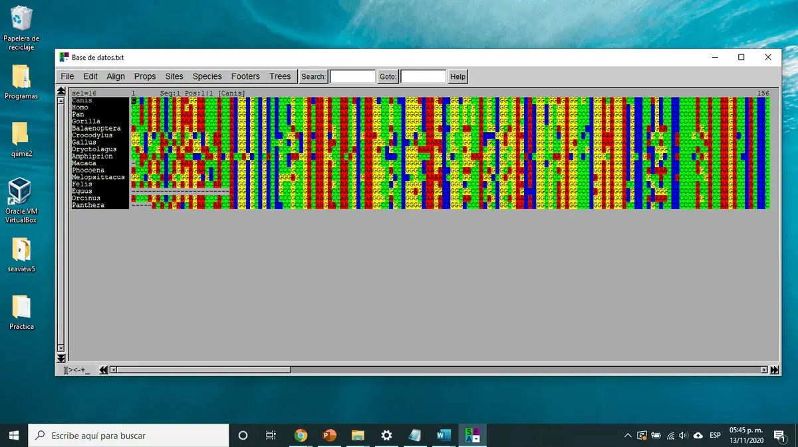

[🏠 Inicio](../README.md) · [← Parte 2](02_base_de_datos_ncbi.md) · **Parte 3** · [Parte 4 →](04_arbol_filogenetico.md)

# 🧩 Parte 3 · Alineamiento múltiple de secuencias

Para comparar secuencias, primero hay que **alinearlas**: acomodarlas de modo que las posiciones homólogas (las que descienden de un mismo nucleótido ancestral) queden en la misma columna.

---

### Paso 13 · Carga tu base de datos en SeaView

Abre SeaView, **arrastra** tu archivo FASTA y suéltalo sobre la ventana.

Deberás ver todas tus secuencias, una por fila:

### Paso 14 · Alinea todas las secuencias

Ve a **Align → Align all**.

### Paso 15 · Revisa el alineamiento

Las secuencias se reacomodarán. Da clic en **OK** cuando termine.

Tu alineamiento se verá parecido a este. Los guiones (`-`) son **huecos** (*gaps*) que el programa inserta para que las posiciones homólogas coincidan.

### Paso 16 · Habilita la edición

Los extremos 5' y 3' suelen ser muy desiguales entre secuencias. Para recortarlos, habilita la edición en **Props → Allow seq editing**.

### Paso 17 · Selecciona todas las secuencias

**Edit → Select All**.

### Paso 18 · Recorta los extremos

Ubícate en una posición donde la **mayoría de las secuencias comiencen** y borra todo lo que esté a la izquierda. Como todas están seleccionadas, al borrar en una se borra en todas.

Resultado después de recortar el extremo 5':

Revisa el extremo 3' y decide si también conviene recortarlo. En este ejemplo el extremo 3' ya estaba bien alineado y no se recortó:

> [!CAUTION]
> **Solo recorta los extremos, nunca el centro.** Borrar nucleótidos del interior elimina información real del gen y altera el resultado.

### Paso 19 · Vuelve a alinear

Después de recortar, repite **Align → Align all**. Compara con el alineamiento anterior: si mejoró y las secuencias tienen longitud similar, puedes continuar. Tú decides si hace falta una tercera ronda.

> [!TIP]
> Guarda tu alineamiento (**File → Save as**) antes de pasar a la siguiente parte, para no repetir el trabajo si algo falla.

---

[🏠 Inicio](../README.md) · [← Parte 2](02_base_de_datos_ncbi.md) · **Parte 3** · [Parte 4: Árbol filogenético →](04_arbol_filogenetico.md)
