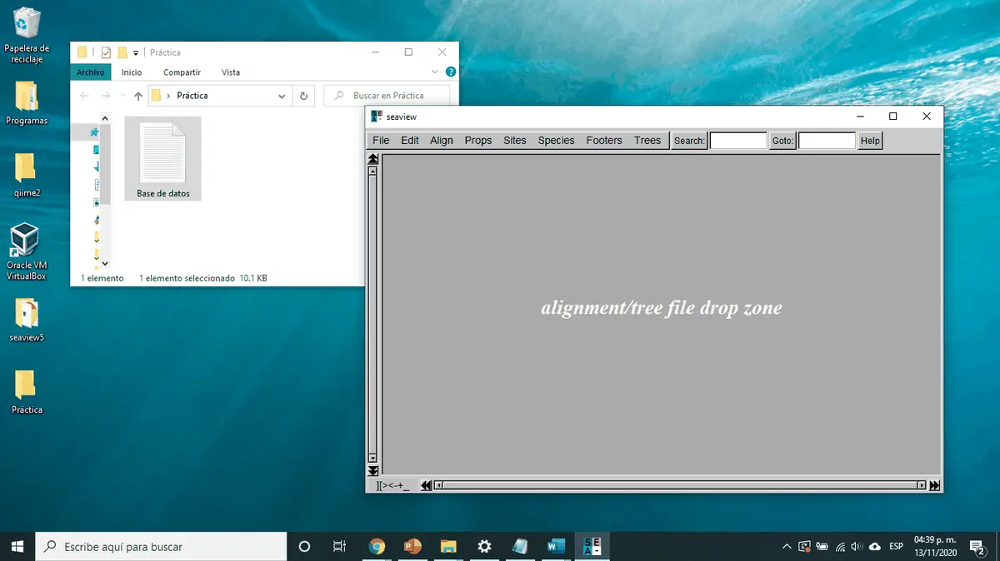
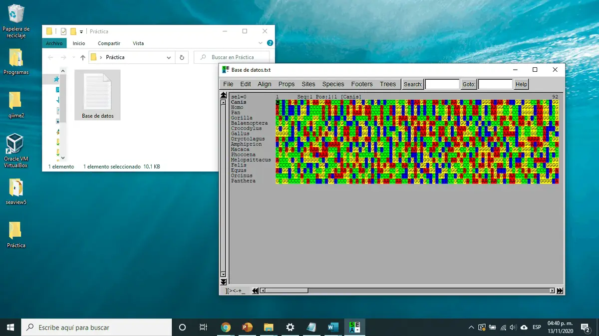
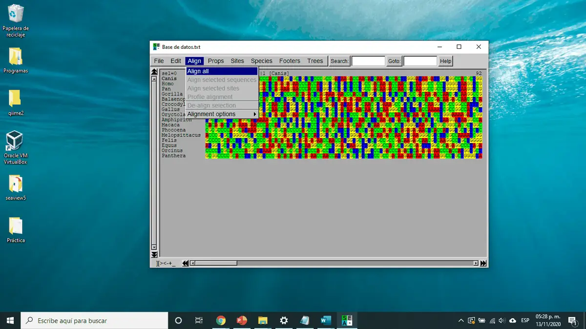
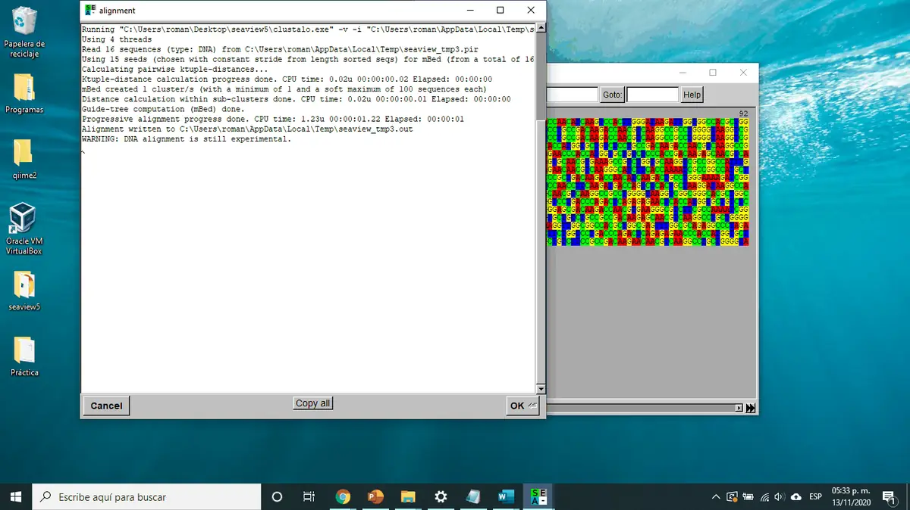
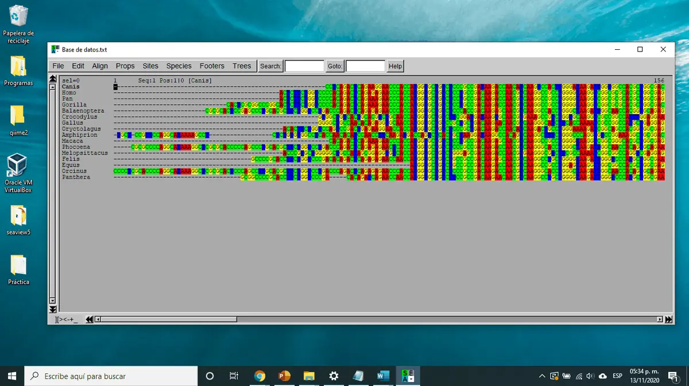

[🏠 Inicio](../README.md) · [← Parte 2](02_base_de_datos_ncbi.md) · **Parte 3** · [Parte 4 →](04_arbol_filogenetico.md)

# 🧩 Parte 3 · Alineamiento múltiple de secuencias

Para comparar secuencias, primero hay que **alinearlas**: acomodarlas de modo que las posiciones homólogas (las que descienden de un mismo nucleótido ancestral) queden en la misma columna.

---

### Paso 13 · Carga tu base de datos en SeaView

Abre SeaView, **arrastra** tu archivo FASTA y suéltalo sobre la ventana.

Deberás ver todas tus secuencias, una por fila:

### Paso 14 · Alinea todas las secuencias

Ve a **Align → Align all**.

### Paso 15 · Revisa el alineamiento

Las secuencias se reacomodarán. Da clic en **OK** cuando termine.

Tu alineamiento se verá parecido a este. Los guiones (`-`) son **huecos** (*gaps*) que el programa inserta para que las posiciones homólogas coincidan. Es normal que los extremos se vean disparejos.

> [!CAUTION]
> **No edites ni borres nucleótidos.** Usa el alineamiento tal como lo genera SeaView.

> [!TIP]
> Guarda tu alineamiento (**File → Save as**) antes de pasar a la siguiente parte, para no repetir el trabajo si algo falla.

---

[🏠 Inicio](../README.md) · [← Parte 2](02_base_de_datos_ncbi.md) · **Parte 3** · [Parte 4: Árbol filogenético →](04_arbol_filogenetico.md)
