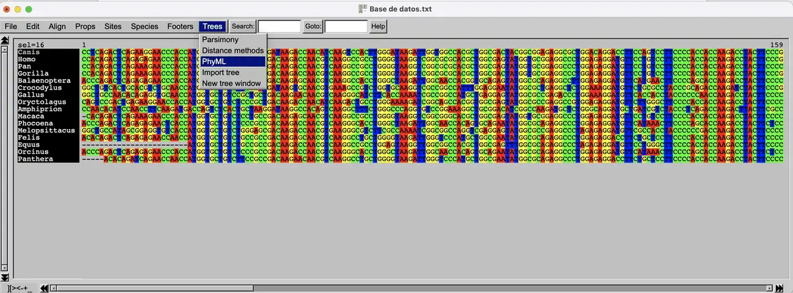
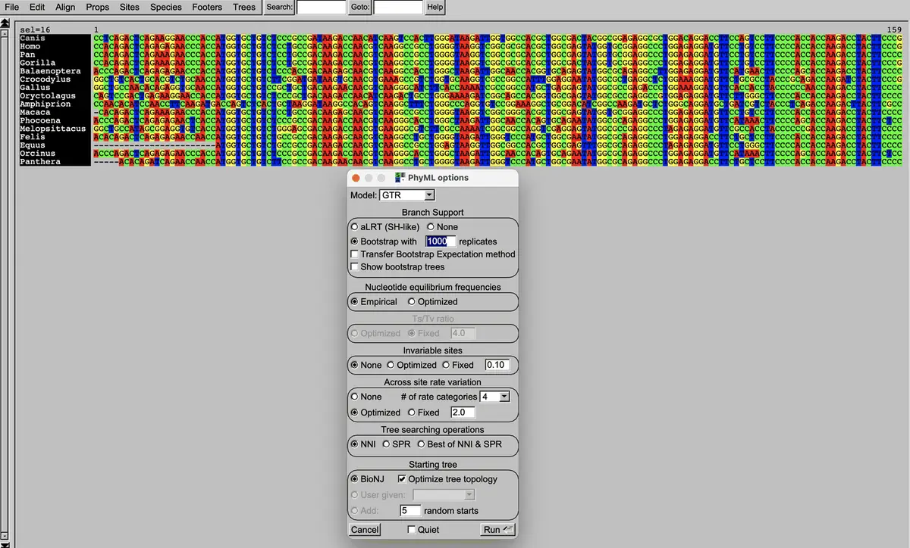
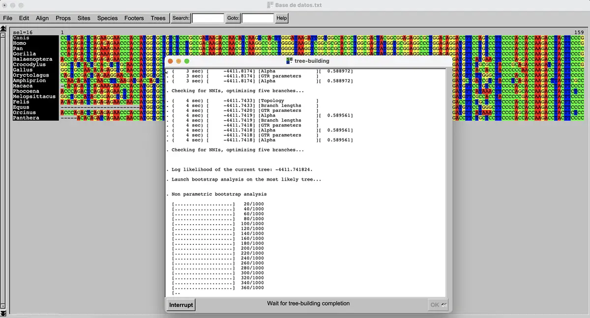
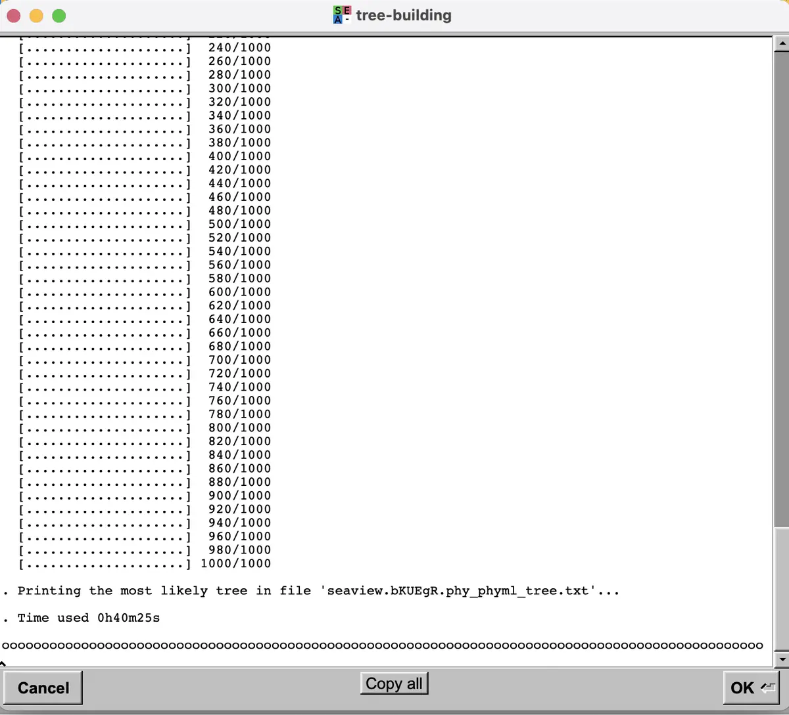
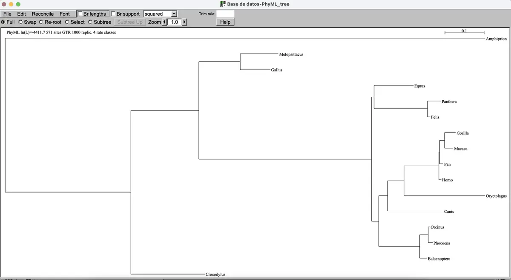
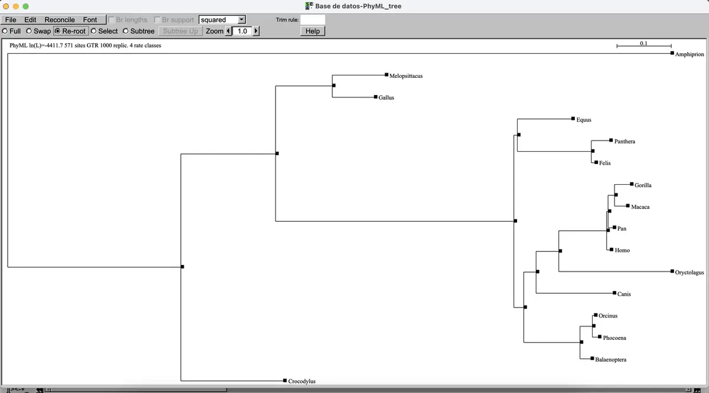
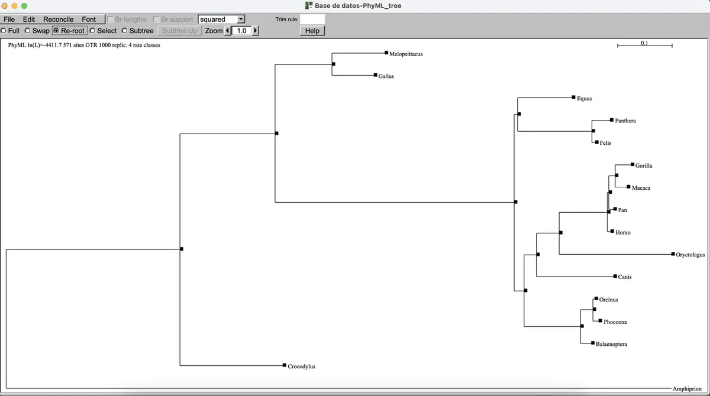
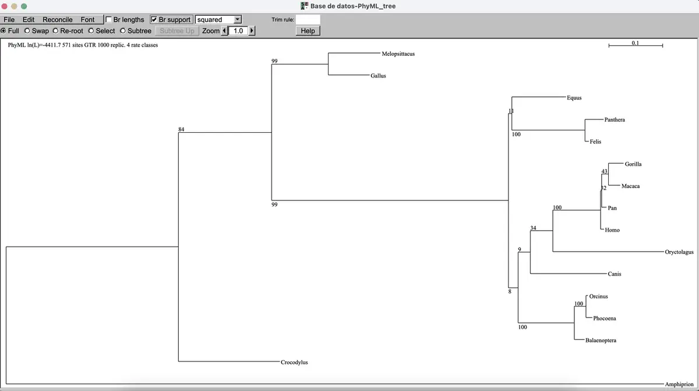
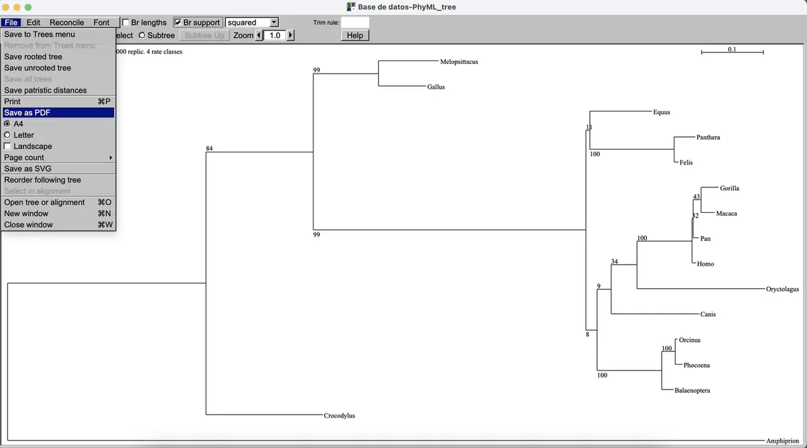

[🏠 Inicio](../README.md) · [← Parte 3](03_alineamiento.md) · **Parte 4**

# 🌳 Parte 4 · Reconstrucción del árbol filogenético

Usaremos **PhyML**, que construye el árbol por **máxima verosimilitud**: busca el árbol con mayor probabilidad de haber producido las secuencias observadas según un modelo de evolución del ADN.

---

### Paso 20 · Abre PhyML

Con tu alineamiento abierto, ve a **Trees → PhyML**.

### Paso 21 · Activa el bootstrap

> [!IMPORTANT]
> La opción **no viene seleccionada**. Marca **Bootstrap with** y escribe **`1000`** replicates. Después da clic en **Run**.

### Paso 22 · Espera el cálculo

PhyML primero obtiene el árbol de máxima verosimilitud y después repite el análisis **1000 veces** con remuestreos del alineamiento. El **valor de bootstrap** de cada rama indica en qué porcentaje de esas réplicas apareció esa misma agrupación: entre más alto, más confiable.

⏱️ **Registra cuánto tardó tu análisis.**

> [!WARNING]
> Puede tardar minutos, horas o incluso días, según el número de secuencias y tu equipo (procesador y RAM). Si a las **24 h** no ha terminado, toma una **captura de pantalla** que muestre cuántas réplicas lleva, interrumpe el análisis y vuelve a correrlo con **500 réplicas**.

### Paso 23 · Observa el árbol

Al terminar aparecerá el árbol filogenético:

### Paso 24 · Enraiza el árbol con el grupo externo

PhyML produce un árbol **sin raíz**. Para darle dirección evolutiva, selecciona **Re-root** y da clic en el cuadro negro del **pez** que incluiste como grupo externo.

La topología (forma) del árbol cambiará:

> [!NOTE]
> El pez funciona como **grupo externo** porque está más alejado evolutivamente de los demás vertebrados de tu lista (mamíferos, aves, reptiles). Todo lo demás debe agruparse "dentro" de él.

### Paso 25 · Muestra los valores de bootstrap

Regresa a **Full** y marca la casilla **Br support** para ver los valores de bootstrap en cada nodo.

### Paso 26 · Guarda tu árbol

**File → Save as PDF**. También existe **Save as SVG**; si tu equipo no abre SVG, puedes convertirlo a PNG o JPG con [Inkscape](https://inkscape.org/es/), o tomar una captura de pantalla del árbol.

### Paso 27 · ¡Listo! 🎉

Ya tienes tu árbol filogenético del gen de la hemoglobina subunidad alfa 1. Continúa con la [plantilla de reporte](../plantillas/reporte_practica.md).

---

## 🔍 ¿Cómo leer el árbol?

| Elemento | Qué significa |
| --- | --- |
| **Hojas** (puntas) | Las secuencias / organismos analizados |
| **Nodos internos** | Ancestros comunes hipotéticos |
| **Clado** | Un ancestro y todos sus descendientes |
| **Longitud de rama** | Cantidad de cambio genético (barra de escala = sustituciones por sitio) |
| **Bootstrap** | % de réplicas que recuperan ese clado. ≥ 70 se considera buen soporte |
| **Raíz** | Punto de origen común, definido por el grupo externo |

---

[🏠 Inicio](../README.md) · [← Parte 3](03_alineamiento.md) · **Parte 4** · [📝 Plantilla de reporte →](../plantillas/reporte_practica.md)
